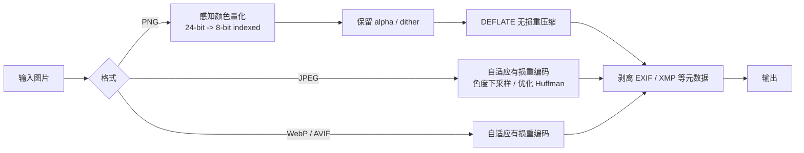
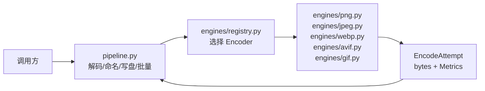

# imagepress

本地、可批量、带感知质量守卫的 TinyPNG 风格图片压缩器。输入 PNG / JPEG / WebP / AVIF / GIF / BMP / TIFF，输出默认保持原格式；用 `uv` 管理依赖，不调用任何在线 API。

**结论先行**

- TinyPNG 的核心不是某个神秘的单点算法，而是一条组合流水线：**感知调色板量化（PNG）→ 元数据剥离 → 强 DEFLATE/无损重压缩**；JPEG/WebP/AVIF 则是**按图像内容自适应的有损重编码**。官方只公开了高层描述，具体感知模型和参数未公开，因此无法逐字节复刻。
- 本实现用 `libimagequant` 复刻 PNG 的量化思路，用 `Oxipng` 做无损收尾；JPEG/WebP/AVIF 用二分搜索寻找满足感知预算的最低质量。所有结果都附带 SSIM、PSNR、CIEDE2000 指标。
- 在仓库自带的 7 个样本上：**3.70 MiB → 1.39 MiB（-62.5%）**，全部样本通过默认感知预算；PNG 截图/渐变/logo 的收益为 72%–77%，照片 PNG 为 60.5%，已压缩过的 JPEG/WebP/AVIF 分别为 38.0% / 31.7% / 54.7%。

```text
uv sync
uv run imagepress samples/photo.jpg          # -> samples/photo.min.jpg
uv run imagepress samples/*.png -o out/ --overwrite  # 批量输出到目录
uv run imagepress samples/photo.png -f webp  # 转成 WebP
```

---

## 1. TinyPNG 调研

### 1.1 官方明确说了什么

来源：[TinyPNG 图片压缩页](https://tinypng.com/web/compress)、[TinyPNG 首页](https://tinypng.com/)、[Tinify API 参考](https://tinypng.com/developers/reference)。

1. **PNG 使用颜色量化。** 官方原文：

   > “When you upload a PNG file, similar colors in your image are intelligently combined. This technique, called **quantization**, reduces the number of colors without noticeably affecting quality. As a result, **24-bit PNG files can be converted into much smaller 8-bit indexed color images**. We also remove unnecessary metadata to further reduce file size.”

   中文：把相似颜色合并，24 位 PNG 变成 8 位索引色 PNG，同时删除不必要的元数据；并保留完整的透明通道。

2. **按图像内容自适应选择压缩级别。** 官方称压缩引擎会考虑颜色、纹理、图案等因素，为每张图选择最佳优化级别，而不是固定质量参数。

3. **“几乎不可见”是官方目标。** 首页/FAQ 的表述是 “The effect is nearly invisible”，并宣称通常可减少 **50–80%**，压缩页另称平均减少 **75%**。这些是 TinyPNG 在其数据集和质量策略下的口径，不能直接套到任意图片。

4. **支持格式。** 当前 Tinify API 支持 AVIF、JPEG XL、WebP、JPEG、PNG，以及 APNG；网页压缩器主要面向 AVIF、WebP、JPEG、PNG。

### 1.2 合理的流程拆解（官方未公开细节）

TinyPNG 没有公开可用的源码或算法规范（截至本次调研）。结合官方描述、PNG/JPEG/WebP/AVIF 的格式约束和公开的同类工具，可以把它的有效流程理解为：



- **PNG**：量化是收益的大头。把上百万种颜色压到最多 256 种，索引图天然比真彩色图小；再用调色板 + DEFLATE 压缩。为了掩盖色阶断层，通常配合 Floyd–Steinberg 等抖动。透明通道可以一起进入调色板。
- **JPEG**：JPEG 本身已经是有损压缩，想继续明显变小只能重编码。业界常见组合是：按感知质量选择量化表、4:2:0 色度下采样、优化 Huffman 表、渐进式编码、剥离元数据。TinyJPG 很可能属于这一类，但具体编码器与参数未公开。
- **WebP / AVIF**：两者都是块级有损编码，通常通过质量/速度参数搜索，在体积和感知质量之间取点。
- **无损收尾**：PNG 的 IDAT 是 DEFLATE 流。除 zlib 外，常用 `libdeflate`、`Zopfli`、`Oxipng` 等进一步压缩。TinyPNG 未公开其后端；本实现默认用 `libdeflate`，`effort=max` 时用 `Zopfli`。
- **元数据**：EXIF、GPS、XMP、注释、缩略图等对渲染通常无用，删除可直接减小文件。ICC 色彩配置则可能影响颜色，不能盲目删除。

### 1.3 为什么人眼不容易察觉

- **颜色冗余**：自然图像/UI 中大量像素颜色非常接近，合并到 256 色后，多数差异落在色觉阈值以下。
- **抖动**：把量化误差扩散到邻近像素，用高频噪声换取更平滑的渐变，避免明显色带。
- **色度下采样**：人眼对亮度细节更敏感，对色度细节不敏感；4:2:0 在相同码率下通常比 4:4:4 更划算。
- **自适应质量**：平坦区域可以更激进，纹理/边缘区域保留更多细节，比“全图固定 q=80”更稳。
- **感知指标验收**：SSIM 关注结构，CIEDE2000 关注颜色；两者一起用比单看 PSNR 更接近人眼。

但“不可见”是统计意义上的。对印刷、医学、法证、带小字的截图、平滑天空等场景，仍应人工复核或使用无损模式。

### 1.4 本实现与 TinyPNG 的对应关系

| TinyPNG 的公开特征 | 本实现 |
|---|---|
| PNG 相似颜色合并为 8-bit 索引色 | `libimagequant` 感知调色板量化，支持 alpha 与 dither |
| 保留透明通道 | PNG/WebP/AVIF 保留 alpha；仅转 JPEG 时按指定背景压平 |
| 删除元数据 | 默认剥离 EXIF/GPS/XMP/注释；ICC 在色彩空间不变时保留 |
| 按图像内容选最佳级别 | PNG 搜索 256/128/64/32 色；JPEG/WebP/AVIF 二分搜索质量 |
| PNG 无损 DEFLATE 收尾 | `Oxipng` + `libdeflate`；`max` 模式用 `Zopfli` |
| “几乎不可见” | SSIM + CIEDE2000 + alpha PSNR 的显式预算 |
| 专有感知模型/参数 | 未复刻；用开源编码器和可解释指标近似 |

**不能声称**本实现与 TinyPNG 输出一致，或在其未公开的质量模型上更优。这里的目标是：在可量化、可复现的“视觉无损”约束下，尽量接近其压缩率。

---

## 2. 实现

### 2.1 代码结构

```text
src/imagepress/
├── __init__.py        # 稳定公共 API（导出、__version__）
├── options.py         # CompressionOptions / Budget（Pydantic，frozen）
├── pipeline.py        # 解码、格式路由、写盘、批量与并发
├── result.py          # CompressionResult / BatchReport（Pydantic）
├── formats.py         # 格式表、别名、后缀、能力矩阵
├── errors.py          # 统一异常层级
├── metrics.py         # SSIM、SSIM(2×)、PSNR、CIEDE2000、alpha PSNR
├── engines/
│   ├── base.py        # Encoder 协议、EncodeContext、质量二分搜索
│   ├── registry.py    # 可替换编码器注册表
│   ├── png.py         # libimagequant + Oxipng
│   ├── jpeg.py        # 自适应质量 + 渐进式
│   ├── webp.py        # 有损/无损 WebP
│   ├── avif.py        # 可选 AVIF 引擎
│   └── gif.py         # 无损动画优化
├── type.py            # Effort / PathLike / Quality 类型别名
├── cli.py             # Click 命令行
├── __main__.py        # python -m imagepress
└── py.typed           # PEP 561 类型标记
scripts/
├── make_samples.py    # 生成本地样本（截图/logo/渐变；照片需一次下载）
└── benchmark.py       # 跑基准、生成预览、更新 README 表格
samples/               # 7 个基准输入
benchmark/             # 压缩输出、预览、results.json / results.md
tests/                 # 指标、引擎、选项、批量行为测试
```

设计边界：`pipeline.py` 只负责“解码 → 选引擎 → 写盘”，不知道任何编解码器
细节；`engines/*.py` 只负责“把一张 Pillow 图像变成 bytes + 指标”，不碰文件
系统。移植时通常只需要替换 `Encoder` 或注册一个自定义引擎。

### 2.2 每种格式怎么压

| 格式 | 主要步骤 | 关键参数 | 失败/兜底 |
|---|---|---|---|
| **PNG** | RGBA → `libimagequant` 调色板（dither，alpha 进调色板）→ `Oxipng`（调色板/位深精简、行滤波、DEFLATE） | `max_colors=256`；auto 依次尝试 256/128/64/32；`dither=1.0` | PNG 调色板未通过感知预算 → 无损 PNG 重压缩 |
| **JPEG** | EXIF 方向校正 → 自适应质量重编码 → 渐进式 + 优化 Huffman；q<90 用 4:2:0，q≥90 用 4:4:4 | auto 在 q=60–95 二分；`effort` 控制搜索/其他编码器 | 同格式重编码不更小 → 保留原文件 |
| **WebP** | 自适应有损重编码，alpha 无损，Sharp YUV | auto q=50–95；method=4（balanced） | 同上 |
| **AVIF** | 自适应 AV1 重编码 | auto q=40–95；speed=6（balanced） | 未安装 `imagepress[avif]` 时明确报错 |
| **GIF** | 保留全部帧，仅做 LZW/调色板无损优化 | `optimize=True` | 不更小则保留原文件；手动 quality 会报错 |
| **BMP / TIFF** | 默认转 PNG，再走 PNG 流水线 | — | 输出格式可显式指定 |
| **16-bit PNG** | 不做有损调色板量化 | — | 仅无损重压缩，保留 16 位 |

补充：

- 已索引的 PNG（P 模式）、灰度 PNG、颜色数 ≤ `max_colors` 的图像直接走无损重压缩，避免无意义的有损转换。
- 同一格式下**绝不写更大的文件**：候选结果不小于原文件时直接保留原文件。
- 动画 GIF 只做无损优化并保留帧数/时长/循环；APNG 和动画 WebP 暂不支持（会明确报错）。
- 多页 TIFF 目前只处理第一页。
- 不支持 SVG、JPEG XL；需要转换格式时请显式指定 `-f/--format`。
- 输出路径默认**不覆盖**已存在文件；显式传 `overwrite=True`（CLI 为 `--overwrite`）
  才会替换。输出路径等于源文件时永远拒绝，避免误删原图。
- AVIF 是可选依赖：`pip install imagepress[avif]`。未安装时其他格式不受影响，
  `available_formats()` 会报告 `AVIF: False`。

### 2.3 感知质量守卫

默认预算：

| 指标 | 默认阈值 | 应用范围 | 说明 |
|---|---:|---|---|
| SSIM | ≥ 0.970 | JPEG / WebP / AVIF / 无损 | 全分辨率，11×11 Gaussian，Rec.709 luma |
| SSIM (2×) | ≥ 0.990 | PNG 调色板 | 2×2 盒式下采样后计算，避免把 dither 当成结构损失 |
| CIEDE2000 均值 | ≤ 2.5 | 全部有损路径 | 颜色偏移的平均水平 |
| CIEDE2000 p95 | ≤ 6.0 | 全部有损路径 | 95% 像素不超过该色差；尾部比均值更重要 |
| alpha PSNR | ≥ 40 dB | 含透明通道的输出 | 防止半透明边缘出现光晕 |

为什么 PNG 用 2× SSIM：Floyd–Steinberg dither 会故意制造高频像素差。全分辨率 SSIM 会把这种“视觉上更平滑”的噪声判成结构损失，导致明明很好看的渐变被误判。2×2 盒式平均能滤掉抖动噪声，同时保留色带、边缘和结构错误。表格里仍同时报告全分辨率 SSIM，便于对比。

`--strict` 会收紧到：SSIM ≥ 0.99、SSIM(2×) ≥ 0.997、ΔE00 均值 ≤ 1.0、p95 ≤ 2.0、alpha PSNR ≥ 45 dB。注意：对已经压缩过的 JPEG，严格预算可能找不到比原文件更小的重编码，此时会保留原文件。

### 2.4 alpha、EXIF 与 ICC

- **alpha**：PNG/WebP/AVIF 原样保留透明通道；PNG 量化时 alpha 与 RGB 一起进入调色板。转 JPEG 时默认压到白色背景，可用 `background=(r,g,b)` 指定其他背景色。
- **EXIF 方向**：编码前调用 `ImageOps.exif_transpose`，把方向真正写进像素；`keep_metadata=True` 时会保留其余 EXIF，并把 Orientation 归零，避免查看器二次旋转。
- **元数据**：默认删除 EXIF/GPS/XMP/注释等；**ICC 在色彩空间不变时保留**，因为删掉它可能改变显示颜色。
- **指标计算**：颜色指标在白色背景上合成透明像素；alpha 单独用 PSNR。宽色域 ICC 没有在指标里做色彩管理，极端情况下指标会偏乐观。

---

## 3. 使用

### 3.1 安装

要求：Python ≥ 3.12、[uv](https://docs.astral.sh/uv/)。

```bash
uv sync                 # 开发环境（含 Ruff、pytest、AVIF 插件）
uv format               # uv 内置的 Ruff 格式化
uv run ruff check src tests scripts
uv tool run ty check src/imagepress
uv run pytest -q        # 43 个测试
uv run imagepress --list-formats
```

或者直接：

```bash
make check              # format + lint + type + test
```

作为库安装：

```bash
pip install imagepress              # PNG/JPEG/WebP/GIF
pip install "imagepress[avif]"      # 额外支持 AVIF
pip install "imagepress[full]"      # 当前等价于 [avif]
```

核心依赖只有 Pillow、NumPy、imagequant、pyoxipng。运行时完全本地，不需要网络，
也不需要 Chrome；Chrome 只在重新生成 `samples/` 里的截图/logo 时使用。

### 3.2 Python 函数

单文件，使用类型化配置：

```python
from imagepress import Budget, CompressionOptions, compress_image

options = CompressionOptions(
    quality="auto",       # auto / 0..100 / "lossless"
    effort="balanced",    # fast / balanced / max
    keep_metadata=False,
    overwrite=True,       # 默认 False：不替换已存在的输出
    budget=Budget(ssim=0.97, ssim_lowfreq=0.99, delta_e_p95=6.0),
)
result = compress_image("samples/photo.jpg", "out/photo.jpg", options=options)

print(result.savings)          # 0.38 = 38% smaller
print(result.metrics.ssim)
print(result.metrics.delta_e_p95)
print(result.target_met)
print(result.note)
```

也可以继续用关键字参数（会构造 `CompressionOptions`）：

```python
result = compress_image(
    "samples/photo.jpg",
    "out/photo.jpg",
    quality="auto",
    effort="balanced",
    overwrite=True,
)
```

批量（目录、并发、逐项失败）：

```python
from imagepress import CompressionOptions, compress_many

report = compress_many(
    ["samples", "assets/logo.png"],
    "out/",
    recursive=True,
    workers=4,
    options=CompressionOptions(overwrite=True),
)
print(report.succeeded, report.failed, f"{report.savings:.1%}")
for failure in report.failures:
    print(failure.source, failure.error_type, failure.message)
```

`compress_many` 不会因为一张坏图中断整批；`results` / `failures` 按输入顺序返回。
如果多个输入在输出目录中会映射到同一个文件名，会在编码前报错，避免静默覆盖。
`on_result` / `on_error` 回调会在每项完成时触发。需要“有任何失败就抛出”时调用
`report.raise_for_failures()`。

只做无损重压缩：

```python
compress_image("screenshots/ui.png", quality="lossless", overwrite=True)
```

转格式：

```python
compress_image("samples/photo.png", "out/photo.webp", format="WEBP")
compress_image("samples/photo.jpg", "out/photo.avif", format="AVIF")
```

严格预算：

```python
from imagepress import Budget, CompressionOptions, compress_image

strict = CompressionOptions(
    budget=Budget(
        ssim=0.99,
        ssim_lowfreq=0.997,
        delta_e_mean=1.0,
        delta_e_p95=2.0,
        alpha_psnr=45.0,
    )
)
compress_image("samples/gradient.png", "out/gradient.png", options=strict)
```

只做吞吐、不做指标计算：

```python
compress_image("samples/photo.jpg", "out/photo.jpg", verify=False, overwrite=True)
```

此时使用保守固定质量（JPEG 82、WebP 80、AVIF 65、PNG 256 色），
`metrics` 与 `target_met` 为 `None`。

从 JSON/YAML 配置构造（Pydantic 校验）：

```python
import json
from imagepress import CompressionOptions, compress_image

config = json.loads(open("imagepress.json").read())
options = CompressionOptions.model_validate(config)
print(options.model_dump())          # 规范化后的配置
result = compress_image("in.png", "out.png", options=options)
```

也可以直接传 mapping，`compress_image` 内部会 `model_validate`：

```python
result = compress_image("in.png", "out.png", options={"quality": 80, "overwrite": True})
```

### 3.3 参数

`compress_image(source, output=None, *, options=..., **overrides)`：

| 参数 | 默认 | 作用 |
|---|---|---|
| `source` | 必填 | 输入文件路径 |
| `output` | `None` | 输出文件或目录；默认 `<stem>.min<ext>` |
| `options` | `None` | `CompressionOptions`、映射（JSON 配置）或 `None` |
| `overrides` | — | 直接传给 `CompressionOptions` 的关键字参数；与 `options` 二选一 |

> 旧版的 `target_ssim=` / `target_delta_e_p95=` 等关键字已移除，统一改为
> `budget=Budget(...)`；其他 `quality` / `effort` / `format` 等关键字仍然可用。

`CompressionOptions`（Pydantic `BaseModel`，`frozen=True`，可跨线程共享）：

| 字段 | 默认 | 作用 |
|---|---|---|
| `format` | `None` | 强制输出 `PNG/JPEG/WEBP/GIF/AVIF`；默认保持原格式，BMP/TIFF → PNG |
| `quality` | `"auto"` | `auto` 感知搜索；`0..100` 固定质量（PNG 按比例缩放调色板）；`"lossless"` 仅去冗余 |
| `max_colors` | `256` | PNG 调色板上限，2..256 |
| `dither` | `1.0` | PNG 抖动强度，0..1 |
| `effort` | `"balanced"` | `fast` / `balanced` / `max`；影响调色板搜索、Oxipng DEFLATE、WebP/AVIF 速度 |
| `keep_metadata` | `False` | 保留 EXIF；ICC 在有效时始终保留 |
| `background` | `(255,255,255)` | 转 JPEG 时压平 alpha 的背景色 |
| `budget` | `Budget()` | 感知预算对象（见下表） |
| `verify` | `True` | 计算 SSIM/PSNR/ΔE00 并驱动质量搜索；`False` 时用固定质量 |
| `overwrite` | `False` | 允许替换已存在的输出；输出等于源文件时永远拒绝 |

`Budget`：

| 字段 | 默认 | 作用 |
|---|---:|---|
| `ssim` | `0.97` | 全分辨率 SSIM 预算（JPEG/WebP/AVIF/无损） |
| `ssim_lowfreq` | `0.99` | PNG 调色板 2× 下采样 SSIM 预算 |
| `delta_e_mean` | `2.5` | CIEDE2000 均值预算 |
| `delta_e_p95` | `6.0` | CIEDE2000 95 分位预算 |
| `alpha_psnr` | `40.0` | alpha 通道 PSNR 预算（dB） |

返回值 `CompressionResult` 是 frozen Pydantic 模型，包含：源/目标路径、源/输出格式、
实际使用的 `encoder`、字节数、节省比例、压缩比、耗时、编码质量、调色板颜色数、
`target_met`、备注，以及 `Metrics`（`ssim`、`ssim_lowfreq`、`psnr_db`、
`delta_e_mean`、`delta_e_p95`、`delta_e_max`、`alpha_psnr_db`）。
`result.as_dict()` 可直接写入 JSON 日志；`result.model_dump(mode="json")` 可用于一般
Pydantic 序列化。

异常层级：`ImagePressError` → `CompressionError` → `OptionError` /
`UnsupportedFormatError` / `DecodeError` / `EncodeError` / `OutputExistsError`。
批量 API 会把单图异常收集为 `BatchFailure`，不让整批中断。

### 3.4 命令行

```bash
# 单文件；输出 samples/photo.min.jpg
uv run imagepress samples/photo.jpg

# 多文件 / 目录到输出目录；目录默认不递归
uv run imagepress samples/ assets/ -o out/ --workers 4

# 递归目录；允许覆盖已有输出
uv run imagepress assets/ -o out/ --recursive --overwrite

# 指定编码质量
uv run imagepress samples/photo.jpg -q 85

# 转 WebP（输出文件名会使用 .min.webp）
uv run imagepress samples/photo.png -f WEBP

# 严格预算
uv run imagepress samples/gradient.png --strict

# 跳过指标计算（吞吐优先）
uv run imagepress samples/photo.jpg --no-verify

# 查看格式与引擎可用性
uv run imagepress --list-formats

# 机器可读
uv run imagepress samples/logo.png --json
```

未指定 `-o` 时默认写 `<stem>.min.<ext>`，且默认不覆盖已存在文件；需要覆盖时加
`--overwrite`。多输入时 `-o` 必须是目录。`--json` 输出
`{"scanned", "elapsed_s", "totals", "results", "failures"}` 结构；有文件失败时
退出码为 1，参数/输出目录错误为 2。

### 3.5 架构与移植

**三层边界**



- **pipeline** 只依赖 `Encoder` 协议，不依赖 Pillow 的 `save` 细节，也不依赖具体
  编码器。
- **Engine** 只接收 `(PIL.Image, EncodeContext)`，返回
  `EncodeAttempt(data=..., metrics=..., quality=..., palette_colors=..., note=...)`；不碰文件系统。
- **Options/Result** 都是 frozen Pydantic 模型，可作为线程间、进程间或 JSON
  边界的数据模型；输入用 `model_validate`，输出用 `model_dump`。

**替换或新增编码器**

```python
from imagepress import EncodeAttempt, EncodeContext, register_encoder


class MyPngEncoder:
    name = "PNG"                 # 注册名；会覆盖内置 PNG 引擎
    supports_lossless = True
    install_hint = ""            # available() 为 False 时展示给用户

    def available(self) -> bool:
        return True              # 例如检查系统二进制是否存在

    def encode(self, image, ctx: EncodeContext) -> EncodeAttempt:
        data = my_backend.encode(  # 你的实现：返回 PNG/JPEG/... bytes
            image,
            quality=ctx.options.quality,
            icc=ctx.icc,
        )
        return EncodeAttempt(
            data=data,
            metrics=ctx.measure(data),   # verify=False 时返回 None
            quality="custom",
            note="my backend",
        )


register_encoder(MyPngEncoder(), replace=True)
```

内置引擎也走同一协议：`PngEncoder`、`JpegEncoder`、`WebpEncoder`、
`AvifEncoder`、`GifEncoder`。新增格式时，在 `formats.py` 的 `FORMATS` 中登记
能力（后缀、是否可编码、是否支持 alpha/无损），然后注册对应引擎；pipeline 会
自动做格式路由。

**移植检查清单**

1. 复制 `src/imagepress/` 即可作为独立库使用；没有项目内相对路径；除编码器
   注册表（带锁）外没有全局可变状态。
2. 若目标系统不用 Pillow 解码，替换 `pipeline._load()`，保持返回
   `_Loaded(image=..., format=..., animated=..., exif=..., icc=..., raw=...)` 的契约。
3. 若目标系统有更快的编码器（系统 `cjpeg`、`pngquant`、GPU/AVIF SDK），实现
   `Encoder` 并注册，不需要改 pipeline、CLI 或指标层。
4. 若不需要质量守卫，传 `verify=False` 可跳过 NumPy 指标计算；若整个系统都不
   需要指标，可用轻量实现替换 `metrics.py`，并让 `EncodeContext.measure()`
   返回 `None`。
5. 若嵌入 Web 服务/任务队列：用 `compress_many(..., workers=N)` 或在外部并发
   调用 `compress_image`；`CompressionOptions` 线程安全，单次调用内的 Pillow
   图像不共享。
6. 若需要多进程：`CompressionOptions`、`CompressionResult` 均可 pickle；把
   `compress_image` 作为顶层函数交给进程池即可。

**依赖边界**

| 层 | 依赖 | 可选 |
|---|---|---|
| 核心 | `pillow`, `numpy` | 否 |
| PNG 引擎 | `imagequant`, `pyoxipng` | 否（TinyPNG 风格量化的关键） |
| AVIF 引擎 | `pillow-avif-plugin` | 是，`imagepress[avif]` |
| 开发 | `pytest`, `ruff` | 是 |

**API 稳定性**：公共名字都从 `imagepress/__init__.py` 的 `__all__` 导出；
`engines.base.Encoder` 与 `EncodeContext` 是移植契约，`pipeline._load` 是解码
替换点（下划线表示内部，但文档化并保持稳定）。

---

## 4. 基准结果

样本覆盖真实照片、照片转 PNG/WebP/AVIF、网页截图、透明 logo、平滑渐变。除 `photo.*` 来自 Lorem Picsum / Unsplash 外，其余为本地生成，保证可复现。所有压缩使用默认 `quality="auto"`、`effort="balanced"`。

<!-- BENCHMARK:START -->
环境：Python 3.13.5 · pillow 13.0.0 · numpy 2.5.4 · imagequant 1.1.5 · pyoxipng 9.1.1 · pillow-avif-plugin 1.6.0 · effort=balanced

| 样本 | 格式 | 原始 | 压缩后 | 节省 | SSIM | SSIM (2×) | PSNR | ΔE00 均值 | ΔE00 p95 | 编码 | 耗时 | 目标 |
|---|---:|---:|---:|---:|---:|---:|---:|---:|---:|---|---:|---|
| `gradient.png` | PNG | 964.4 KiB | 238.7 KiB | 75.2% | 0.9710 | 0.9926 | 42.6 dB | 0.75 | 2.14 | PNG 127c | 3.80s | 通过 |
| `logo.png` | PNG | 28.5 KiB | 7.8 KiB | 72.7% | 0.9886 | 0.9987 | 42.6 dB | 0.21 | 1.34 | PNG 32c | 1.02s | 通过 |
| `photo.avif` | AVIF | 252.6 KiB | 114.5 KiB | 54.7% | 0.9700 | 0.9909 | 37.7 dB | 1.59 | 3.84 | AVIF q64 | 4.48s | 通过 |
| `photo.jpg` | JPEG | 296.6 KiB | 183.9 KiB | 38.0% | 0.9703 | 0.9944 | 37.4 dB | 1.52 | 3.77 | JPEG q82 | 3.18s | 通过 |
| `photo.png` | PNG | 1.54 MiB | 625.2 KiB | 60.5% | 0.9738 | 0.9955 | 38.7 dB | 2.29 | 5.49 | PNG 256c | 2.50s | 通过 |
| `photo.webp` | WEBP | 214.2 KiB | 146.2 KiB | 31.7% | 0.9724 | 0.9897 | 38.1 dB | 1.66 | 3.90 | WEBP q81 | 4.34s | 通过 |
| `screenshot.png` | PNG | 456.1 KiB | 105.1 KiB | 77.0% | 0.9948 | 0.9978 | 45.6 dB | 0.59 | 1.36 | PNG 128c | 6.50s | 通过 |
| **合计** |  | **3.70 MiB** | **1.39 MiB** | **62.5%** |  |  |  |  |  |  | **25.81s** |  |

> SSIM 为全分辨率值（含抖动噪声），SSIM (2×) 为 2×2 盒式下采样后的值，PNG 调色板路径的验收使用的是后者。ΔE00 为 CIEDE2000，越小越好；p95 ≤ 6、均值 ≤ 2.5、SSIM (2×) ≥ 0.99、alpha PSNR ≥ 40 dB 为默认预算。

### 100% 局部对比

**photo.jpg** — 左：原图；中：压缩后；右：差异 ×8。


**screenshot.png** — 左：原图；中：压缩后；右：差异 ×12。


**gradient.png** — 左：原图；中：压缩后；右：差异 ×12。


> 预览为 1:1 像素裁剪，避免缩放掩盖压缩痕迹。差异图经过放大，黑色表示完全相同；高倍放大后的噪声/dither 并不等于肉眼可见的差异。

> `photo.jpg` 来自 Lorem Picsum / Unsplash；`photo.png`、`photo.webp`、`photo.avif` 由同一张照片派生；`screenshot.png`、`logo.png`、`gradient.png` 为本地生成。
<!-- BENCHMARK:END -->

**解读**

- PNG 类（截图/渐变/logo）收益最大：截图 -77.0%，渐变 -75.2%，透明 logo -72.7%。这些图颜色冗余高，256/128/32 色足以通过预算。
- 照片保存成 PNG 时收益 60.5%（256 色 + dither），代价是 ΔE00 p95 5.49；这是“视觉接近”而非数学无损。
- 已压缩的 JPEG/WebP 收益分别 38.0% / 31.7%，属于正常现象：源文件已经过有损编码，二次压缩空间更小。
- AVIF 源再压缩收益 54.7%，因为源是 q90；自适应搜索找到了 q64。
- 所有 7 个样本都通过默认预算；没有文件被放大。总耗时约 26 秒（当前机器一次运行；包含每张图的多次编码与指标计算），单张约 1–7 秒；不同机器/负载会有浮动。
- TinyPNG 官方“平均 75%”是其跨数据集/质量策略的口径，与本表 62.5% 不可直接比较；本表默认守卫更保守，且包含已压缩格式。

复现：

```bash
uv run python scripts/benchmark.py
```

脚本会重写 `benchmark/results.json`、`benchmark/results.md`、`benchmark/previews/`，并自动替换 README 中 `BENCHMARK` 标记之间的内容。

---

## 5. 局限与注意事项

- **有损不可逆**：`quality="auto"` 在 PNG/JPEG/WebP/AVIF 上是有损的；重要原图请保留备份。需要像素级不变时用 `quality="lossless"`（JPEG/AVIF 会拒绝；WebP 会无损重编码）。
- **指标不是人眼**：SSIM/CIEDE2000 是代理指标，不能覆盖所有内容（小字、细线、肤色、医学影像、印刷）。对质量敏感的场景请人工复核，或收紧预算。
- **宽色域**：ICC 会被保留，但指标在 sRGB 数值上计算，未做完整色彩管理。
- **PNG 的天花板**：调色板最多 256 色。对平滑渐变/照片，默认可能使用 256 色或回退无损；若需要更大压缩率，可转 WebP/AVIF（通常更小）。
- **GIF 仅无损**：GIF→GIF 只做 LZW/调色板无损优化，不做颜色量化，也不支持把其他格式转成 GIF；动画会被保留。手动 `quality=0..100` 会被拒绝，请用 `auto` 或 `lossless`。
- **默认不覆盖**：`compress_image` / `compress_many` 的 `overwrite=False`，CLI 需要 `--overwrite` 才会替换已存在输出；输出等于源文件时始终拒绝。
- **AVIF 元数据**：`pillow-avif-plugin` 对 EXIF 的支持有限；`keep_metadata=True` 时 EXIF 可能被编码器丢弃，ICC 仍会尽量保留。以实际解码结果为准。
- **动画/多页**：APNG、动画 WebP 不支持；多页 TIFF 只处理第一页。
- **格式**：不支持 SVG、JPEG XL；BMP/TIFF 只作为输入。
- **内存**：指标在整张图上计算；超大图（数千万像素）会占用较多内存，建议先分块/缩放业务图。
- **不是 TinyPNG 的封装**：没有调用 TinyPNG/Tinify API，也不声称与其输出一致。

---

## 6. 参考

- TinyPNG 官方压缩说明：<https://tinypng.com/web/compress>
- TinyPNG 首页：<https://tinypng.com/>
- Tinify API 参考（格式列表）：<https://tinypng.com/developers/reference>
- pngquant / libimagequant：<https://pngquant.org/lib/>
- Oxipng：<https://github.com/shssoichiro/oxipng>
- pyoxipng：<https://github.com/nfrasser/pyoxipng>
- MozJPEG（常见 JPEG 优化编码器，本项目未使用）：<https://github.com/mozilla/mozjpeg>
- WebP：<https://developers.google.com/speed/webp>
- AVIF：<https://aomediacodec.github.io/av1-avif/>
- Zopfli：<https://github.com/google/zopfli>
- Pillow：<https://python-pillow.org/>
- pillow-avif-plugin：<https://github.com/fdintino/pillow-avif-plugin>
- SSIM：Wang et al., *Image quality assessment: from error visibility to structural similarity*, IEEE TIP 2004.
- CIEDE2000：Sharma et al., *The CIEDE2000 color-difference formula: Implementation notes, supplementary test data, and mathematical observations*, Color Research & Application 2005.
