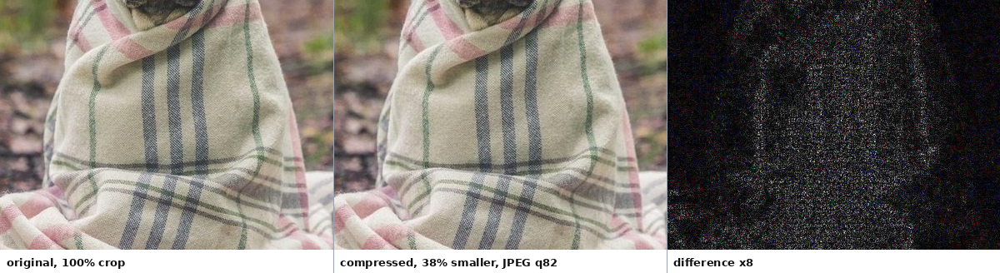
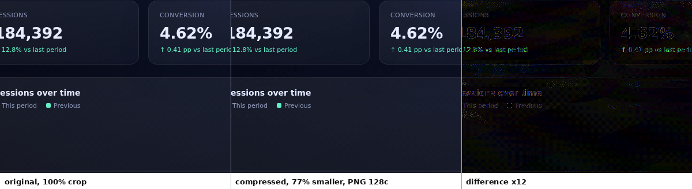
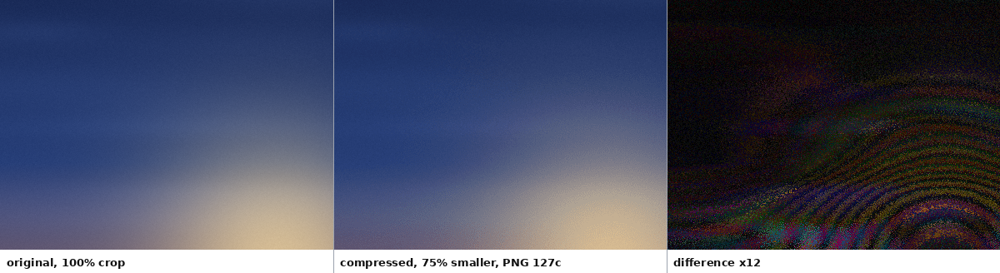

环境：Python 3.13.5, Pillow 13.0.0, NumPy 2.5.4, imagequant 1.1.5, pyoxipng 9.1.1, AVIF plugin 1.6.0, effort=balanced

| 样本 | 格式 | 原始 | 压缩后 | 节省 | SSIM | SSIM 2x | PSNR | ΔE00 均值 | ΔE00 p95 | 编码 | 耗时 | 目标 |
|---|---:|---:|---:|---:|---:|---:|---:|---:|---:|---|---:|---|
| `gradient.png` | PNG | 964.4 KiB | 238.7 KiB | 75.2% | 0.9710 | 0.9926 | 42.6 dB | 0.75 | 2.14 | PNG 127c | 7.24s | 通过 |
| `logo.png` | PNG | 28.5 KiB | 7.8 KiB | 72.7% | 0.9886 | 0.9987 | 42.6 dB | 0.21 | 1.34 | PNG 32c | 1.89s | 通过 |
| `photo.avif` | AVIF | 252.6 KiB | 114.5 KiB | 54.7% | 0.9700 | 0.9909 | 37.7 dB | 1.59 | 3.84 | AVIF q64 | 9.92s | 通过 |
| `photo.jpg` | JPEG | 296.6 KiB | 183.9 KiB | 38.0% | 0.9703 | 0.9944 | 37.4 dB | 1.52 | 3.77 | JPEG q82 | 5.60s | 通过 |
| `photo.png` | PNG | 1.54 MiB | 625.2 KiB | 60.5% | 0.9738 | 0.9955 | 38.7 dB | 2.29 | 5.49 | PNG 256c | 4.62s | 通过 |
| `photo.webp` | WEBP | 214.2 KiB | 146.2 KiB | 31.7% | 0.9724 | 0.9897 | 38.1 dB | 1.66 | 3.90 | WEBP q81 | 8.25s | 通过 |
| `screenshot.png` | PNG | 456.1 KiB | 105.1 KiB | 77.0% | 0.9948 | 0.9978 | 45.6 dB | 0.59 | 1.36 | PNG 128c | 12.10s | 通过 |
| **合计** |  | **3.70 MiB** | **1.39 MiB** | **62.5%** |  |  |  |  |  |  | **49.62s** |  |

> SSIM 为全分辨率值，包含抖动噪声。SSIM 2x 为 2x2 盒式下采样后的值，PNG 调色板路径使用它验收。ΔE00 为 CIEDE2000，越小越好。p95 ≤ 6，均值 ≤ 2.5，SSIM 2x ≥ 0.99，alpha PSNR ≥ 40 dB 为默认预算。

### 100% 局部对比

**photo.jpg**。左：原图；中：压缩后；右：差异 ×8。

**screenshot.png**。左：原图；中：压缩后；右：差异 ×12。

**gradient.png**。左：原图；中：压缩后；右：差异 ×12。

> 预览为 1:1 像素裁剪，避免缩放掩盖压缩痕迹。差异图经过放大，黑色表示完全相同；高倍放大后的噪声/dither 并不等于肉眼可见的差异。

> `photo.jpg` 来自 Lorem Picsum / Unsplash；`photo.png`、`photo.webp`、`photo.avif` 由同一张照片派生；`screenshot.png`、`logo.png`、`gradient.png` 为本地生成。
